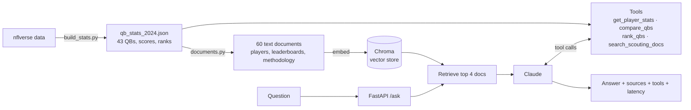

# NFL Scout AI

An AI scouting assistant for 2024 NFL quarterbacks. A Claude agent combines **retrieval-augmented generation (RAG)** over QB scouting documents with **tool calls** into a custom weighted scoring model, served through a **FastAPI** endpoint and measured with an **automated evaluation suite**.

Built as a rapid "Version 0.1" prototype on top of my earlier [QB-Comparison-Tool](https://github.com/aclark4/QB-Comparison-Tool).

A real response (lightly trimmed):

```text
Q: Who's better, Joe Burrow or Josh Allen?

By Adam Clark's weighted formula, Josh Allen is better, 4.13 to -0.39, a margin of 4.52 [tool:compare_qbs].
- Sacks taken (3.4 points, favors Allen): Burrow took 48 sacks versus Allen's 14.
- EPA per play (0.97, favors Allen): Allen led qualifying QBs at 0.32; Burrow was at 0.19.
- Turnovers (0.90, favors Allen): Burrow's turnover penalty was larger.
Burrow's main edge was total yards per game (2.61 points): 4,918 passing yards to Allen's 3,731.

sources: player:Joe Burrow, player:Josh Allen, leaderboard:epa_play, leaderboard:pass_yards
tools: compare_qbs · latency: 8.2 s
```

## How it works



1. **Precompute.** `build_stats.py` pulls seven nflverse datasets once, runs the scoring formula for every QB with 100+ attempts, and saves a small JSON file. The service never downloads data at runtime.
2. **Documents.** Each QB becomes a scouting summary with league ranks ("EPA per play 0.30, 2nd of 43"), plus one leaderboard per metric and a document explaining the scoring formula.
3. **Retrieve.** Chroma embeds the documents locally (all-MiniLM-L6-v2) and returns the four closest to each question.
4. **Generate with tools.** Claude answers from the retrieved context and calls tools for anything exact: player stats, rankings, or a head-to-head comparison with a per-component **score breakdown** showing which parts of the formula decided the result.
5. **Log.** Every request is written to `logs/requests.jsonl` with latency, tools used, sources, and token usage.

## Evaluation

`eval/run_eval.py` runs 17 questions with known answers (pulled directly from the data) in two modes and grades them automatically:

- **rag_only**: retrieved documents only, no tools (baseline)
- **rag_tools**: the full agent

Questions cover single-stat lookups (including a last-name-only and a misspelled name), comparisons, rankings, methodology, and **out-of-scope trick questions** (Tom Brady in 2024, playoff stats, receivers) that pass only if the agent declines instead of inventing an answer.

Model: `claude-haiku-5-5` · 17 questions per mode

| Mode | Accuracy | Correct tool used | Median latency | Avg tokens / question |
|---|---|---|---|---|
| rag_only | 16/17 (94%) | n/a | 1.7 s | 1,727 |
| rag_tools | **17/17 (100%)** | **12/12 (100%)** | 2.5 s | 5,763 |

| Category | rag_only | rag_tools |
|---|---|---|
| lookup | 5/5 | 5/5 |
| comparison | 2/2 | 2/2 |
| ranking | 4/5 | 5/5 |
| methodology | 2/2 | 2/2 |
| out_of_scope | 3/3 | 3/3 |

### Findings

- **Retrieval misses on vocabulary.** "Which quarterback threw the deepest passes?" failed in the baseline because the leaderboard is titled "average depth of target," and semantic search didn't connect the two. The baseline model *declined* rather than guessing; the full agent recovered by calling `rank_qbs`.
- **No hallucinations.** All three out-of-scope questions were declined in both modes, across both runs.
- **Tools trade cost for reliability.** The agent uses about 3x the tokens and about 0.8 s more latency, in exchange for correct rankings and exact comparisons.
- **The first eval run caught a bug in the eval itself.** The baseline initially scored 88% because its system prompt still told it to call tools it didn't have, and it emitted a fake tool call as text. Giving the baseline its own prompt made the comparison fair (88% → 94%).
- **Mocks weren't enough.** All unit tests passed with a fake Claude client, but the first real API call returned a content-block type the fake never produced. The agent now passes Claude's response blocks back unchanged.
- **The score breakdown exposed a bias in my formula.** Sacks, interceptions and fumbles are season totals, so durability is penalized: in Allen vs. Burrow, raw sacks taken (48 vs. 14) is the single largest factor.

### Recommendation: Iterate

The prototype answers the feasibility question: tool-augmented RAG is accurate on this data, declines out-of-scope questions, and explains its reasoning. It is not ready to scale yet:

1. **Grow the eval set** from 17 to 50+ questions, including multi-step and ambiguous ones, before trusting the 100%.
2. **Fix vocabulary misses** with query rewriting or hybrid keyword + vector search.
3. **Route by question type.** Simple lookups could skip tools or use a cheaper path; comparisons and rankings need tools.
4. **Normalize the formula** to per-game or per-attempt rates so it measures quality, not durability.

## Quickstart

Requires Python 3.11 and an [Anthropic API key](https://console.anthropic.com).

```bash
conda create -n nfl-scout python=3.11 -y && conda activate nfl-scout
pip install -r requirements.txt
cp .env.example .env              # paste your ANTHROPIC_API_KEY into .env

python retriever.py --rebuild     # build the vector index (first run downloads an ~80 MB embedding model)
python agent.py "Who was best at avoiding sacks under pressure?"
uvicorn app:app --reload          # then open http://localhost:8000/docs
```

`data/qb_stats_2024.json` is committed, so `build_stats.py` (which downloads the full play-by-play data) is only needed to regenerate it.

### Docker

```bash
docker build -t nfl-scout-ai .
docker run --rm -p 127.0.0.1:8000:8000 --env-file .env nfl-scout-ai
```

### API

```bash
curl -X POST http://localhost:8000/ask \
  -H "Content-Type: application/json" \
  -d '{"question": "Compare Jared Goff and Baker Mayfield"}'
```

Returns `answer`, `sources`, `tools_used`, `model`, `latency_ms`, and token `usage`. Also available: `GET /health`, `GET /players`.

### Tests and evaluation

```bash
pytest -q                  # 33 unit tests, no API calls (fake Claude client, offline embeddings)
python eval/run_eval.py    # live evaluation, writes eval/results/latest.md
```

## Project structure

| File | Purpose |
|---|---|
| `qb_stats.py` | Stat extraction across seven nflverse datasets and the weighted scoring formula with per-component breakdown |
| `build_stats.py` | Precomputes stats, scores and ranks for every qualifying QB |
| `documents.py` | Turns stats into player summaries, leaderboards and a methodology document |
| `retriever.py` | Chroma vector index: build and search |
| `tools.py` | Exact-data tools for the agent, with fuzzy name matching |
| `agent.py` | RAG + tool-use loop with Claude |
| `app.py` | FastAPI service with request logging |
| `eval/` | Questions with known answers, evaluation runner, saved results |
| `tests/` | Unit tests for scoring, retrieval, tools, agent loop, API and grader |

## Built with AI assistance

I used Claude as a pair programmer throughout: refactoring my original CLI into an importable, testable module, generating unit tests with mock data, scaffolding the retrieval and agent layers, and debugging. Every change was reviewed and validated against the real data and the live API, and several of the findings above (the unexpected content-block bug, the unfair baseline prompt, the formula's durability bias) came from checking AI-generated work against real results.

## Data

Play-by-play, Next Gen Stats, Pro Football Reference and FTN charting data from [nflverse](https://github.com/nflverse) via `nfl_data_py`. 2024 regular season, QBs with 100+ pass attempts.
